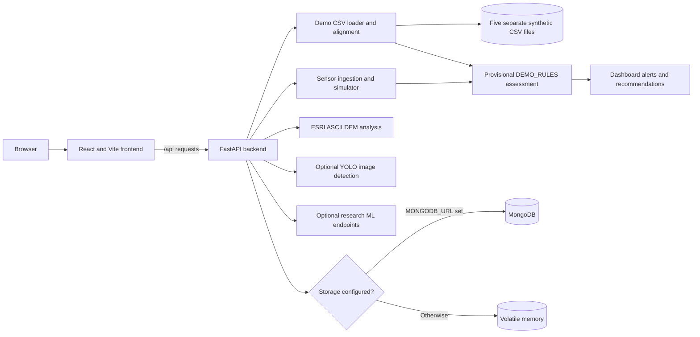

# GeoGuards

An open-pit mine monitoring **software prototype**. Its built-in readings, zone geometry, risk rules, and alarm indicators are demonstrations, not validated safety forecasts or actual mine measurements. Do not use it for operational safety decisions.

## Run locally

Requirements: Python 3.11+, Node.js 20+. MongoDB is optional for local demonstration and required for durable history.

```bash
cd backend
python3 -m venv .venv
source .venv/bin/activate
pip install -r requirements.txt
uvicorn app.main:app --reload
```

In another terminal:

```bash
cd frontend
npm install
npm run dev
```

Open http://localhost:5173. API documentation is at http://localhost:8000/docs. Copy `.env.example` to `.env` to configure MongoDB or the frontend URL. With no `MONGODB_URL`, history is held in memory and is lost on restart. Start the simulator in the UI; it is off by default. The default scenario is `normal` and readings are sent through the same `/api/sensors` ingestion path used by future physical devices.
When using `uvicorn --reload`, every backend code change restarts the process and clears in-memory history; reimport the demo CSV sample or configure MongoDB if you need it to survive reloads.

To test the supplied CSVs, open **Sensor Data** and select **Load supplied CSV sample**, or run `curl -X POST 'http://localhost:8000/api/demo/import?limit_per_location=30'`. This imports the most recent 30 historical samples per CSV location into the ordinary sensor/history/dashboard workflow. The import is repeatable and skips existing demo readings. Inspect file validation with `curl http://localhost:8000/api/demo/datasets`; the three supplied positive-only synthetic events can be inspected at `/api/demo/events` and on Reports. The five source CSVs remain separate in `datasets/demo/`; their provenance, schemas, alignment and unit limitations are documented in [datasets/demo/README.md](datasets/demo/README.md). No event labels are imported or interpreted as negative labels. `datasets/real/` is reserved for future measured data.

Run backend tests with `cd backend && .venv/bin/python -m pytest -q tests`. Run frontend checks with `cd frontend && npm run build`. Optional research ML dependencies and training gates are documented in [docs/ML_PIPELINE.md](docs/ML_PIPELINE.md).

## Architecture



The dashboard uses provisional rules by default. Research ML endpoints do not imply that a validated rockfall model is installed. The five demo datasets remain separate and are aligned internally by timestamp and location ID.

## Deploy on Render

Deploy the frontend and backend as **two services from the same GitHub repository**. Push the version you want to deploy to the selected branch first. The basic deployment needs no source-code changes.

1. In Render, choose **New → Web Service**, connect this repository, and select the branch to deploy. Use **Python 3** and the **Free** instance type if this is a demonstration.

   | Backend setting | Value |
   | --- | --- |
   | Root Directory | Leave blank (repository root) |
   | Build Command | `pip install -r backend/requirements.txt` |
   | Start Command | `cd backend && uvicorn app.main:app --host 0.0.0.0 --port $PORT` |

   Leave Root Directory blank: the backend reads `datasets/demo/` from the repository root. A backend-only root directory would exclude those files on Render. Once deployed, open `https://YOUR-BACKEND.onrender.com/api/health` and confirm `status` is `ok`. Save the backend URL.

2. Choose **New → Static Site**, connect the same repository and branch, and set:

   | Frontend setting | Value |
   | --- | --- |
   | Root Directory | `frontend` |
   | Build Command | `npm ci && npm run build` |
   | Publish Directory | `dist` |
   | Environment variable | `VITE_API_URL=https://YOUR-BACKEND.onrender.com` |

   Use the backend origin without `/api` or a trailing slash. `VITE_API_URL` is included in the frontend build, so redeploy the static site after changing it. Save the frontend URL.

3. In the backend Web Service's **Environment** settings, add `FRONTEND_URL=https://YOUR-FRONTEND.onrender.com` using the exact static-site origin, without a trailing slash. Redeploy the backend so its CORS setting accepts browser requests from the frontend.

4. Verify the frontend, `/api/health`, `/api/demo/datasets`, and `/docs` on the backend URL. In **Sensor Data**, load the supplied CSV sample and confirm readings and history appear. If browser requests fail with a CORS error, compare `FRONTEND_URL` with the frontend address exactly. If demo files are reported missing, check that the backend Root Directory is blank and that all five CSVs were pushed to the repository.

For durable history, configure an external MongoDB service and set its connection string as the backend's `MONGODB_URL` environment variable. `DATABASE_NAME` defaults to `geoguards`. Keep credentials in Render environment settings, never in Git. Without MongoDB, readings and alerts are held in memory and reset when the service restarts; if MongoDB is configured but unreachable, the backend fails startup rather than switching silently to memory.

On Render's Free plan, the backend spins down after inactivity and can take about a minute to wake. The frontend currently times out API calls after eight seconds; before a live demonstration, open the backend `/api/health` URL and wait for it to respond, then refresh the frontend. Render's free filesystem is temporary, so uploaded files and locally installed model weights do not persist across restarts. The basic backend build does not install optional YOLO dependencies or weights; image detection will show its unavailable state. See [Render's free-service limits](https://render.com/docs/free) for current plan details.

This deployment uses only synthetic demonstration data and is not a mine safety system. The API has no authentication; add access controls before connecting real data or making the service available for operational use.

## What is implemented

- Warm, responsive React monitoring workspace with sidebar navigation for dashboard, map, alerts, risk analysis, sensors, terrain analysis, image detection, reports and settings. The dashboard map is a self-contained fictional zone schematic, and Live Map has an interactive fictional 3D pit model. Neither is surveyed mine geometry.
- FastAPI ingestion, history, prediction, alert, simulator, detection and dashboard endpoints.
- Correlated, time-dependent readings for three fictional simulator zones, plus bounded import of the supplied historical synthetic CSV readings for ten `LOC_` locations. Every built-in reading has `source: "simulated"`.
- Transparent provisional risk rules with factors, input timestamps and illustrative safety actions. Sensor receipt status and assessment history are visible. `risk_probability` is `null` until a validated model is supplied. No claim of real-world accuracy is made.
- Optional MongoDB collections for readings, predictions, alerts, zones, detections and simulation sessions. If configured but unavailable, the API fails startup rather than silently losing durability.
- Image upload validation and a truthful unavailable state when geological YOLO weights are absent. Optional YOLO inference and bounding boxes are available only with configured weights and dependencies, and remain explicitly unvalidated. No fabricated detections.
- ESRI ASCII DEM upload with descriptive elevation, slope, aspect and local-roughness statistics. Zone association is an unverified tag; no geographic map overlay or hazard score is inferred.
- Dashboard-only rule and test alarms with factors, recommended actions, deduplication and acknowledgement. Historical CSV imports do not create current alerts. No real SMS, email, siren or warning-light hardware is activated.
- Research Random Forest and XGBoost preparation, evaluation and inference modules are available behind separate ML endpoints. No real-data model is trained or activated; the dashboard still uses `DEMO_RULES`. Synthetic test fixtures never become deployable model artifacts.

## Next data and integration steps

The phase-by-phase status and remaining scientific gates are in [docs/PHASE_STATUS.md](docs/PHASE_STATUS.md). Candidate public data sources and their limits are in [docs/REAL_DATA_REVIEW.md](docs/REAL_DATA_REVIEW.md).

To analyze a DEM, upload an ESRI ASCII grid on **Terrain Analysis** or call `POST /api/terrain/analyze`. No raster is bundled. For local **general object detection demo**, run `pip install -r requirements-vision.txt` and `python scripts/setup_vision_demo.py` from `backend/`, then restart FastAPI. The image page will show YOLO object boxes and label the result `general_objects_demo`. This model does not recognize geological hazards or predict rockfall. For reviewed task-specific weights, set `GEOLOGICAL_YOLO_WEIGHTS` to a trusted local `.pt` file. `GET /api/detect/status` reports the active mode; configured geological inference remains unvalidated until mine-site evaluation.

To replace the baseline with ML, obtain genuine measurements and independently verified rockfall events, assess label quality and leakage, split by mine/site and time where appropriate, evaluate against a baseline, then deploy a versioned model. The supplied three synthetic rule-generated positive event labels are for software integration only and do not establish scientific accuracy; absent event rows are not verified negatives. To enable geological image detection, obtain appropriately licensed annotated images and train and validate task-specific YOLO weights. To build a real map, provide surveyed mine boundaries and DEM data. Real notifications and hardware require configured recipients, credentials, delivery testing and a safety review. None of those real-world assets are included here.

## API overview

`POST /api/sensors`, `GET /api/sensors/latest`, `GET /api/sensors/history`, `GET /api/sensors/status`, `POST /api/predict`, `GET /api/predictions`, `GET /api/predictions/latest`, `GET /api/models/status`, `GET /api/ml/status`, `GET /api/ml/comparison`, `POST /api/ml/predict`, `GET /api/ml/assessments`, `POST /api/detect`, `GET /api/detect/status`, `GET /api/detections`, `POST /api/terrain/analyze`, `GET /api/terrain/analyses`, `GET /api/alerts`, `POST /api/alerts/test`, `PATCH /api/alerts/{id}/acknowledge`, simulator start/stop/scenario/status, and dashboard summary/risk-distribution. All inputs and outputs are described in Swagger UI.

## Prototype limitations

The thresholds in `backend/app/services/risk.py` are invented for a UI demonstration and need qualified geotechnical review. Risk percentages are zone distributions, not event probabilities. The app has no authentication; a public deployment must use synthetic, non-sensitive demonstration data only. The simulator uses fictional zones and coordinates. Notification delivery is intentionally disabled, even if credentials are set.
